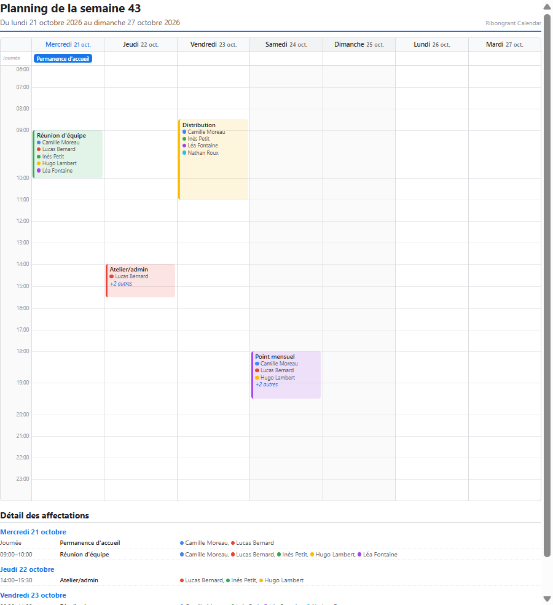

<div align="center">


# Ribongrant Calendar

<sub>un produit **Ribongrant Studio**</sub>

### Organiser les répartitions des membres, simplement.

**Solution desktop & mobile** pour piloter l'affectation des personnes sur les missions
quotidiennes d'une **petite structure** — TPE, association, club, collectif — là où un
tableur et un agenda ne suffisent plus.

[](https://www.electronjs.org)
[](https://react.dev)
[](https://vite.dev)
[](https://expo.dev)
[](https://reactnative.dev)
[](https://www.typescriptlang.org)
[](https://www.sqlite.org)
[](https://tailwindcss.com)
[](https://fullcalendar.io)

[Documentation mobile](mobile/README.md) · [Signaler un bug](https://github.com/mishat19/ribongrant_calendar/issues) · [Licence](#-licence)

</div>

---

## 🎯 Pourquoi Ribongrant Calendar ?

Dans une TPE de 6 personnes ou une association de 30 bénévoles, la question quotidienne
est simple mais?torturante :

> *« Qui est dispo ce matin, et sur quelle mission je le mets ? »*

Savoir qui est disponible, trouver les personnes qui **ne le sont pas**, composer un
planning réaliste et le **partager** — c'est un travail de secrétariat à temps partiel,
répété chaque semaine.

**Ribongrant Calendar** fait ce travail à votre place :

- 📅 un **calendrier** (mois / semaine / jour) qui devient votre tableau de service ;
- 👥 un **annuaire des membres** avec leurs **disponibilités** réelles ;
- 🎯 des **affectations** directly sur le créneau, avec la liste des disponibles ;
- 🖨️ un **PDF du planning** prêt à imprimer ou à envoyer par mail.

---

## ✨ Points clés

### 🎯 Affectations

- Affecter **un ou plusieurs membres** à chaque mission, en un clic depuis le créneau.
- Le panneau d'affectation sépare trois listes : **affectés**, **disponibles**,
  **indisponibles** — on sait d'un coup d'œil qui est eligible.
- Les affectations sont **par occurrence** : une mission récurrente peut être confiée
  à une personne différente chaque semaine, sans jamais dupliquer l'événement.
- Affectation possible sur toute la journée entière, pas seulement sur un créneau horaire.
- Chaque membre porte une **couleur** : on repère immédiatement qui est sur quel créneau.

### 🕒 Disponibilités

- Modèle simple et réaliste : **jour × période × rythme**.
  - *Périodes* : matin, midi, après-midi, soir.
  - *Rythmes* : chaque semaine, semaines paires, semaines impaires.
- Les membres **indisponibles** sont automatiquement signalés au moment d'affecter,
  et les besoins de recrutement sont visibles d'un coup d'œil.

### 🗂️ Missions & membres

- Catalogue de **missions** réutilisables (libellé + emoji), attaché aux membres.
- Fiche membre complète : nom, rôle, email, téléphone, couleur, missions, disponibilités.
- Recherche plein écran sur les événements (titre, description) sur la version mobile.

### 🖨️ Export PDF du planning

- **Planning hebdomadaire A4** prêt à imprimer : grille horaire, événements,
  couleurs, affectés sous chaque événement.
- Mise en page **adaptative** : les lignes horaires s'agrandissent pour que
  **tous les bénévoles d'un créneau restent visibles**, même quand il y en a cinq ou six.
- **Pagination automatique** si la semaine ne tient pas sur une page (en-têtes répétés),
  avec un **« Détail des affectations »** qui reprend la liste exhaustive par jour.
- Export **direct sur disque** (bureau) ou **partage** depuis le téléphone.

### 📱 Desktop **&** mobile, même modèle de données

| | Bureau | Mobile |
|---|---|---|
| Technologie | Electron + React + Vite | Expo (React Native) |
| Base de données | SQLite locale | SQLite locale |
| Vues | Mois / Semaine / Jour | Mois / Semaine / Jour |
| Affectations | ✅ panneau latéral | ✅ bottom sheet |
| PDF | ✅ enregistrement | ✅ partage |
| Rappels | — | ✅ notifications locales |
| Hors-ligne | ✅ | ✅ |

Les deux applications partagent **exactement le même schéma de données** : un planning
préparé sur l'ordinateur se retrouve sur le téléphone (export / import du fichier `.db`).

---

## 🖨️ Aperçu du PDF

Le planning exporté tient sur une page A4 et affiche **tous** les affectés d'un
créneau — même quand ils sont nombreux.

<div align="center">
  
</div>

---

## 🖥️ Version bureau (Electron)

- **Vues Mois / Semaine / Jour** (FullCalendar) avec vue **aujourd'hui**, ligne de
  l'heure courante, indicator de récurrence.
- **Glisser-déposer** un événement pour le déplacer, **redimensionner** pour changer sa durée.
- Création d'un événement au clic sur un créneau ou un jour.
- Récurrence **quotidienne / hebdomadaire / mensuelle** avec date de fin.
- Panneau d'**affectation** ancré au bloc (jamais coupé par le calendrier).
- Page **Membres** : fiches, missions, disponibilités, couleurs.
- Export / import de la **base de données** complète (menu *Fichiers*).
- Génération du **PDF** via le moteur d'impression Chromium (`printToPDF`).

### 🚀 Démarrer

```bash
# installation
npm install

# interface + serveur API (développement)
npm run dev:all

# application Electron complète (Vite + Electron + serveur)
npm run electron:dev

# build de l'exécutable Windows (portable ou installeur)
npm run build:electron
npm run build:electron:installer
```

### 📁 Où sont mes données ?

Une **seule base de données par utilisateur**, partagée par l'application installée et
le mode développement :

| Système | Chemin |
|---|---|
| Windows | `%APPDATA%\ribongrant_calendar\data.db` |
| Linux | `~/.config/Ribongrant Calendar/data.db` |
| macOS | `~/Library/Application Support/Ribongrant Calendar/data.db` |

> ⚠️ Le serveur de développement (`npm run dev:api`) utilise le même dossier via la
> variable `APP_DATA_DIR` du fichier `.env` : sinon le mode dev travaillerait sur une
> autre base que l'application du bureau, et les données seraient « perdues » d'un
> environnement à l'autre.

Les exports (`Fichiers ▾ ▸ Exporter BDD`) sont des **copies cohérentes** de la base
(le journal *WAL* est inclus), et l'import remplace le contenu de la base
immédiatement : pas besoin de redémarrer l'application.

---

## 📱 Version mobile (Expo / React Native)

- Design **Material 3** inspiré de Google Calendar, thème **clair / sombre** automatique.
- **Bottom tabs** : Calendrier & Membres.
- Grilles **mois / semaine / jour** maison, swipe horizontal pour changer de période.
- **Tap sur un créneau** pour créer un événement d'une heure.
- Fiche événement en *bottom sheet* : détail, modification, suppression, affectation.
- **Rappels** par notification locale (au moment, 5/10/30/60 min avant, 1 jour avant).
- **Export / import** de la base `.db` par partage système.
- **PDF du planning** généré via `expo-print` puis partagé (mail, WhatsApp, Drive…).

### 🚀 Démarrer

```bash
cd mobile
npm install

# serveur Expo (scanner le QR code avec Expo Go)
npx expo start

# build de développement Android (requis pour les notifications locales)
npx expo run:android
```

> 📱 Les notifications locales ne fonctionnent pas dans Expo Go sur Android depuis le SDK 53 :
> utilisez un *development build* (`npx expo run:android` ou `npx eas build --profile development`).

---

## 🧱 Architecture

```
ribongrant_calendar/
├── electron/          # Process principal Electron + pont IPC (export PDF)
├── server/            # API Express + schéma SQLite (better-sqlite3)
├── src/               # Interface React/Vite (Tailwind CSS + FullCalendar)
│   ├── pages/         # CalendarPage, MembersPage
│   └── lib/           # availability, weekPlanningPdf, timegridSlots
├── mobile/            # Application Expo / React Native (TypeScript)
│   ├── src/app/       # Routes expo-router (calendrier, événement, recherche)
│   ├── src/components/# Vue mois / semaine / jour, feuilles, assignation
│   ├── src/db/        # Schéma SQLite, requêtes, migrations
│   ├── src/domain/    # Types, dates, récurrences, disponibilités
│   ├── src/lib/       # PDF, notifications, sauvegarde
│   └── src/store/     # Zustand (événements, équipe, préférences)
└── docs/              # Illustrations du README
```

### 🗄️ Modèle de données (commun aux deux apps)

| Table | Rôle |
|---|---|
| `events` | missions planifiées (début, fin, journée entière, couleur, récurrence) |
| `attributions` | membre × événement × **occurrence** |
| `members` | fiches membres (nom, rôle, email, téléphone, couleur) |
| `missions` | catalogue de missions (libellé, emoji) |
| `member_missions` | rattachement membre ↔ mission |
| `availabilities` | membre × jour × période × rythme |
| `mission_slots` | créneaux fixes par mission (journée type) |

---

## 🔒 Données & confidentialité

- **100 % local** : tout est stocké dans un fichier SQLite sur votre machine.
- **Aucun compte, aucun cloud, aucun envoi de données** : l'application fonctionne
  hors-ligne, en réseau fermé.
- **Sauvegarde** : export du fichier `.db` en un clic, réimportable sur l'autre poste
  ou sur le mobile.

---

## 🧪 Vérifications

```bash
# bureau
npm run lint            # oxlint

# mobile
cd mobile
npx tsc --noEmit        # typage
npx expo lint           # eslint (config Expo)
```

---

## 📄 Licence

Projet développé par **Ribongrant Studio**.

> ⚠️ Le fichier `LICENSE` n'a pas encore été ajouté au dépôt : le choix de la
> licence (MIT, AGPL-3.0, licence propriétaire…) reste à faire.

---

<div align="center">

**Ribongrant Studio** · *Ribongrant Calendar*
<sub>Conçu pour celles et ceux qui n'ont pas le temps de remplir un tableau Excel.</sub>

</div>
